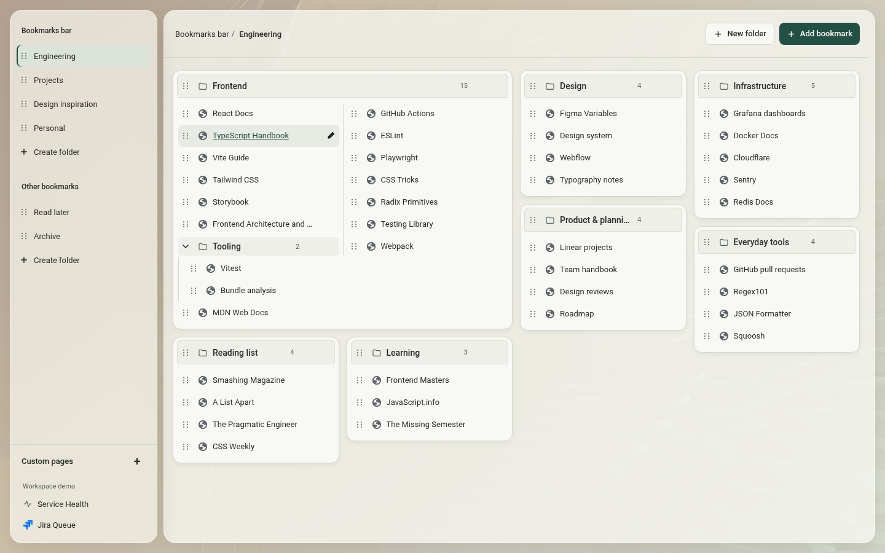
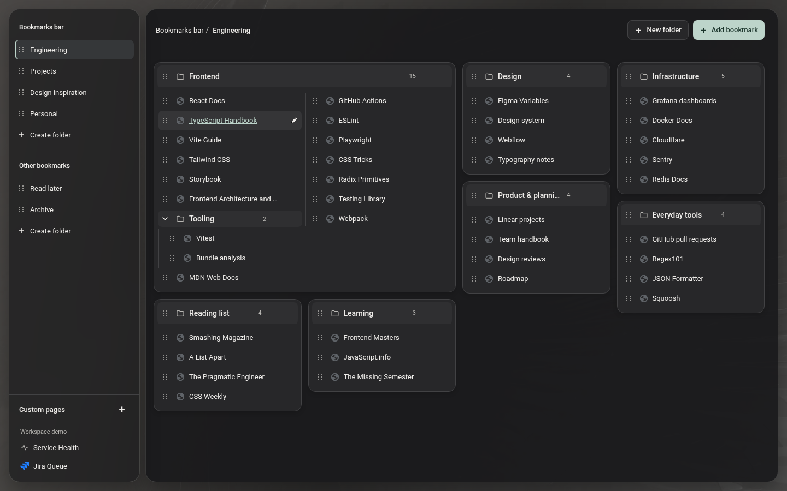

# FolderTabber

A browser extension for Chromium and Firefox that replaces the New Tab page with
a folder-based view of your existing bookmarks. Built with React, TypeScript and Vite, using Manifest V3.

## Screenshots

### Light theme



### Dark theme



## Features

- Browse bookmark folders through the sidebar and breadcrumbs.
- View nested folders in an adaptive masonry layout. Large cards can span two
  columns; expanding a nested folder keeps cards in their existing columns.
- Create, rename, edit and delete folders and bookmarks.
- Move and reorder items with drag and drop across the grid, sidebar and breadcrumbs.
- Open bookmarks in tab groups named after the currently selected folder.
- Use a collapsible sidebar on narrow windows.
- Connect your own HTTP providers to add custom pages with tables, forms, metrics, actions and page-specific CSS.

Changes are written directly to the browser's bookmarks. The selected folder is
saved in the browser's local extension storage; bookmark data is loaded from the
browser when the extension starts.

## Install a release

Releases include CRX and ZIP builds for Chromium, plus a Mozilla-signed XPI for Firefox
140+ on desktop. The steps below describe Chromium installation.

1. Download `folder-tabber-<version>.zip` from [Releases](https://github.com/setafd/folder-tabber/releases)
   and extract it to a folder you will keep on disk.
2. Open `chrome://extensions/` and enable **Developer mode**.
3. Choose **Load unpacked** and select the extracted folder containing `manifest.json`.
4. Open a new tab.

Releases also include a signed CRX for browsers and environments that support
[local CRX installation](https://developer.chrome.com/docs/extensions/how-to/distribute/install-extensions).

## Build from source

Use Node.js 24, matching CI, and pnpm 12.23.0, as pinned in `package.json`.
See the [pnpm installation guide](https://pnpm.io/installation) if pnpm is not installed.

```sh
git clone https://github.com/setafd/folder-tabber.git
cd folder-tabber
pnpm install --frozen-lockfile
pnpm build
```

Load the generated `build/` directory through **Load unpacked** on
`chrome://extensions/`. After rebuilding, reload the extension on that page and
open a new tab to use the updated build.

Installing dependencies runs `prepare`, which configures Git to use `.githooks/`.
The pre-commit hook runs ESLint and the test suite and blocks the commit if either fails.

### Firefox

Download `folder-tabber-firefox-<version>.xpi` from Releases, then open
`about:addons` and use **Install Add-on From File** in the settings menu.

To build and try the extension locally:

```sh
pnpm build:firefox
```

The Firefox build is written to `build-firefox/`, separately from the Chromium
build in `build/`. It uses a Firefox-specific manifest and supports tab groups.

To try it locally, open `about:debugging#/runtime/this-firefox`, choose
**Load Temporary Add-on**, and select `build-firefox/manifest.json`. Open a new tab
and accept the new-tab override if Firefox prompts you. Temporary add-ons are
removed when Firefox restarts. Permanent installation in Firefox Release requires
[Mozilla signing](https://extensionworkshop.com/documentation/publish/signing-and-distribution-overview/).

Firefox uses site icons available from open tabs, with a bundled globe icon for
other bookmarks. Chromium uses its built-in favicon service.

## Custom pages

Connect your own provider to open dashboards, task lists, or forms from the sidebar. Providers return JSON and can include page-specific CSS.

See the [Custom Pages provider API](docs/custom-pages.md) for endpoints, response fields, and icons.
